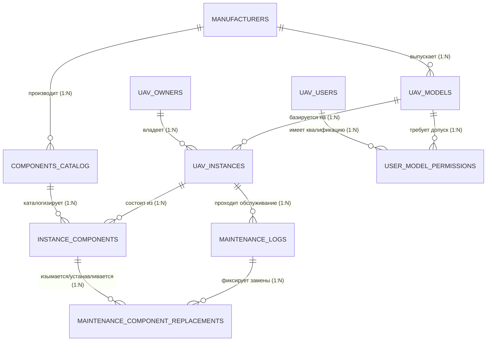

# База Данных: Гражданские БПЛА в России (uav_civil_db)

Данная база данных (Итерация №1) спроектирована для учета физических экземпляров гражданских беспилотных воздушных судов (БВС), отслеживания их конструктивного состава (компонентов), ведения истории технического обслуживания и ремонтов (ТОиР), а также контроля собственников и допусков внешних пилотов согласно нормативной базе РФ.

---

## Быстрый запуск всей системы через Docker Compose

Для того чтобы развернуть базу данных со всеми таблицами, связями и настройками в один клик без ручного ввода SQL-кода, в проекте настроена автоматическая сборка.

### Инструкция по запуску:
1. Скачайте и запустите приложение [Docker Desktop](https://docker.com). Убедитесь, что индикатор в левом нижнем углу загорелся **зеленым** (*Engine running*).
2. Откройте терминал (**Git Bash**, cmd или терминал вашей IDE) в корневой папке нашего проекта.
3. Выполните команду для сборки и фонового запуска контейнера:
   ```bash
   docker compose up -d
   ```
4. База данных автоматически поднимется, настроит внутренние связи и применит структуру таблиц из папки `./init-scripts`.

### Реквизиты для подключения (DBeaver / DataGrip):
* **Host (Хост):** `localhost`
* **Port (Порт):** `5432`
* **Database (База данных):** `uav_civil_db`
* **Username (Пользователь):** `postgres`
* **Password (Пароль): uav_password

### Полезные команды управления в Git Bash:
* Остановить базу данных: `docker compose stop`
* Запустить остановленную базу: `docker compose start`
* Полностью удалить контейнер (с сохранением данных): `docker compose down`
* Полностью сбросить базу и накатить скрипты заново с нуля (очистка кэша): 
  ```bash
  docker compose down -v && docker compose up -d
  ```

---

## 1. Пользовательские типы данных (Enums)

Для обеспечения строгости и типизации на уровне СУБД используются следующие перечисления:
* `uav_aerodynamic_schema`: Конструктивные схемы БПЛА (`Fixed-wing`, `Multirotor`, `VTOL`, `Helicopter`).
* `uav_weight_category`: Законодательные категории массы в РФ (`Under_150g`, `150g_to_30kg`, `Over_30kg`).
* `uav_instance_status`: Текущее состояние борта (`Active`, `Maintenance`, `Storage`, `Decommissioned`).
* `maintenance_type`: Виды регламентных работ (`Pre-flight`, `Post-flight`, `TO-1`, `TO-2`, `Seasonal`).
* `owner_legal_type`: Юридический статус собственника (`Individual`, `IP`, `LE`).

---

## 2. Описание таблиц и полей

### Таблица `manufacturers` (Производители)
Хранит данные о заводах-изготовителях воздушных судов, полетных контроллеров, двигателей и других комплектующих.
* `manufacturer_id` (SERIAL, PK): Уникальный идентификатор записи.
* `name` (VARCHAR, UNIQUE): Наименование компании (например, ООО "Геоскан").
* `country` (VARCHAR): Страна базирования (по умолчанию — "Россия").
* `inn` (VARCHAR): ИНН юридического лица/ИП для прозрачной интеграции с госреестрами.
* `website` (VARCHAR): Официальный сайт.
* `contact_phone` (VARCHAR): Контактный номер телефона.
* `created_at` (TIMESTAMP): Дата и время добавления записи.

### Таблица `uav_owners` (Владельцы БПЛА)
Реестр собственников гражданских беспилотников (физические лица, ИП и организации).
* `owner_id` (SERIAL, PK): Идентификатор владельца.
* `legal_type` (ENUM): Юридический статус контрагента (`Individual`, `IP`, `LE`).
* `name` (VARCHAR): ФИО физического лица или официальное наименование организации.
* `inn` (VARCHAR): ИНН собственника.
* `ogrn` (VARCHAR): ОГРН или ОГРНИП.
* `snils` (VARCHAR): СНИЛС (необходим для физических лиц при подаче заявлений в Росавиацию).
* `contact_email` / `contact_phone` (VARCHAR): Контактные данные.
* `legal_address` (TEXT): Юридический/фактический адрес регистрации.

### Таблица `uav_users` (Пилоты / Операторы)
Реестр специалистов, имеющих доступ к управлению и эксплуатации техники.
* `user_id` (SERIAL, PK): Идентификатор пользователя.
* `first_name` / `last_name` / `middle_name` (VARCHAR): Полные ФИО пилота.
* `pilot_license_number` (VARCHAR): Номер свидетельства внешнего пилота (критично для аппаратов тяжелее 30 кг).
* `license_issue_date` / `license_expiry_date` (DATE): Сроки действия лицензии пилота.
* `medical_certificate_number` (VARCHAR): Справка ВЛЭК (врачебно-летной экспертной комиссии).
* `phone` (VARCHAR, UNIQUE) / `email` (VARCHAR, UNIQUE): Контакты сотрудника.
* `is_active` (BOOLEAN): Статус активности (уволен / отстранен / в штате).

### Таблица `uav_models` (Модели БПЛА)
Справочник серийно выпускаемых линеек беспилотных комплексов.
* `model_id` (SERIAL, PK): Идентификатор модели.
* `manufacturer_id` (INT, FK): Ссылка на разработчика (`manufacturers`).
* `model_name` (VARCHAR): Название модели (например, "Supercam S350").
* `aerodynamic_schema` (ENUM): Аэродинамическая схема комплекса.
* `weight_category` (ENUM): Весовая категория для нормативного контроля.
* `mtow_kg` (NUMERIC): Максимальная взлетная масса (MTOW) в килограммах.
* `max_flight_time_mins` (INT): Предельная длительность нахождения в воздухе.
* `max_range_km` (NUMERIC): Максимальный радиус/дальность действия.
* `cruising_speed_kmh` (INT): Крейсерская скорость движения.
* *Ограничение*: Уникальный составной индекс на пару `(manufacturer_id, model_name)`.

### Таблица `user_model_permissions` (Допуски пилотов к моделям)
Связующая таблица (Многие-ко-Многим) для фиксации права пилота управлять конкретным типом техники.
* `permission_id` (SERIAL, PK): Идентификатор допуска.
* `user_id` (INT, FK): Ссылка на пилота (`uav_users`).
* `model_id` (INT, FK): Ссылка на модель беспилотника (`uav_models`).
* `granted_date` (DATE): Дата выдачи квалификационного допуска.
* `insurance_policy_number` (VARCHAR): Номер полиса обязательного страхования ответственности владельца перед третьими лицами, привязанный к пилоту.

### Таблица `uav_instances` (Физические борты БПЛА)
Конкретные физические единицы (коптеры/самолеты), имеющие уникальные номера.
* `instance_id` (SERIAL, PK): Идентификатор конкретного борта.
* `model_id` (INT, FK): Ссылка на базовую модель (`uav_models`).
* `owner_id` (INT, FK): Ссылка на текущего законного владельца (`uav_owners`).
* `serial_number` (VARCHAR, UNIQUE): Заводской серийный номер изделия.
* `rosaviatsia_number` (VARCHAR): Номер государственного учета, присвоенный Росавиацией.
* `production_date` (DATE): Точная дата сборки/выпуска.
* `total_flight_time_hours` (NUMERIC): Суммарная общая наработка (налёт) борта в часах.
* `current_status` (ENUM): Эксплуатационный статус машины.
* `last_update` (TIMESTAMP): Время последнего изменения карточки борта.

### Таблица `components_catalog` (Каталог запчастей / BOM)
Справочник номенклатуры запасных частей и модулей полезной нагрузки.
* `component_type_id` (SERIAL, PK): Идентификатор типа компонента.
* `manufacturer_id` (INT, FK): Ссылка на производителя детали (`manufacturers`).
* `part_number` (VARCHAR, UNIQUE): Заводской артикул детали.
* `component_name` (VARCHAR): Коммерческое наименование (например, "Li-Ion 6S 21700").
* `category` (VARCHAR): Категория, защищенная ограничением `CHECK` (значения: `Airframe`, `Engine_Electric`, `Engine_ICE`, `ESC`, `Autopilot`, `GNSS_RTK`, `Telemetry_Radio`, `Battery`, `Payload_Optics`, `Payload_LiDAR`, `Rescue_System`).
* `mtbf_hours` (INT): Гарантированный ресурс или средняя наработка на отказ (MTBF) в часах.
* `weight_g` (INT): Вес детали в граммах для весового контроля.
* `specifications` (JSONB): Документ JSON со свободными парами "ключ-значение" под разные ТТХ (тяга мотора, разрешение матрицы камеры, емкость батареи).

### Таблица `instance_components` (Установленные на борт детали)
Показывает физический состав («сборку») каждого конкретного БПЛА в данный момент времени.
* `installed_component_id` (SERIAL, PK): Идентификатор установленной единицы.
* `instance_id` (INT, FK): Ссылка на борт БПЛА (`uav_instances`).
* `component_type_id` (INT, FK): Ссылка на номенклатуру из каталога (`components_catalog`).
* `component_serial_number` (VARCHAR, UNIQUE): Уникальный серийный номер конкретного мотора, платы или камеры.
* `installation_date` (DATE): Дата монтажа узла на беспилотник.
* `component_operating_hours` (NUMERIC): Наработка конкретно этого узла в часах (сбрасывается или учитывается при ремонтах).
* `is_active` (BOOLEAN): Флаг активности (`TRUE` — деталь сейчас стоит на дроне, `FALSE` — снята/списана).

### Таблица `maintenance_logs` (Журнал ТОиР)
История всех сервисных мероприятий, проверок и инспекций техники.
* `log_id` (SERIAL, PK): Номер записи ТО.
* `instance_id` (INT, FK): Ссылка на обслуженный борт (`uav_instances`).
* `type_of_maintenance` (ENUM): Регламент выполненных работ (`Pre-flight` ... `Seasonal`).
* `maintenance_date` (TIMESTAMP): Точная дата и время проведения обслуживания.
* `uav_operating_hours_at_maintenance` (NUMERIC): Зафиксированный налёт часов борта на момент заезда в сервис.
* `description` (TEXT): Текстовое описание дефектов, замечаний и выполненных процедур.
* `engineer_name` (VARCHAR): ФИО инженера, проводившего работы и подписавшего акт.
* `next_maintenance_date` (DATE): Плановая дата следующей обязательной проверки.

### Таблица `maintenance_component_replacements` (Замены при ремонте)
Фиксирует изменения в составе оборудования БПЛА, произошедшие в рамках конкретного сервисного лога.
* `replacement_id` (SERIAL, PK): Идентификатор операции замены.
* `log_id` (INT, FK): Ссылка на документ обслуживания (`maintenance_logs`).
* `removed_component_id` (INT, FK): Ссылка на демонтированную деталь (`instance_components`), у которой флаг `is_active` переводится в `FALSE`.
* `installed_component_id` (INT, FK): Ссылка на новую установленную деталь.
* `reason_for_replacement` (TEXT): Причина (например, "деструкция лопастей после грубой посадки").

---

## 3. Визуальная схема связей (ER-диаграмма)

Ниже представлена структура связей между сущностями. GitHub и DataGrip автоматически визуализируют этот блок в виде интерактивной схемы со стрелочками:



### Текстовое описание правил удаления (Foreign Key Constraints)

* ⚠️ **`ON DELETE RESTRICT` (Запрет удаления источника):**
  * `manufacturers` ➔ `uav_models` / `components_catalog` — нельзя удалить завод, если в базе зарегистрированы его дроны или детали.
  * `uav_models` ➔ `uav_instances` — нельзя удалить модель БПЛА, пока существует хотя бы один живой борт.
  * `uav_owners` ➔ `uav_instances` — нельзя удалить карточку владельца, пока на него записана техника.
  * `components_catalog` ➔ `instance_components` — нельзя удалить деталь из каталога, если она физически смонтирована на каком-то дроне.

* ⚙️ **`ON DELETE CASCADE` (Каскадное автоматическое удаление):**
  * `uav_instances` ➔ `instance_components` / `maintenance_logs` — если физический борт окончательно удаляется из системы, автоматически стирается его текущая компоновка и история его ремонтов.
  * `maintenance_logs` ➔ `maintenance_component_replacements` — при удалении акта техобслуживания удаляются связанные записи о заменах деталей в этой сессии.
  * `uav_users` ➔ `user_model_permissions` — при удалении профиля пилота стираются все его допуски к полетам.
